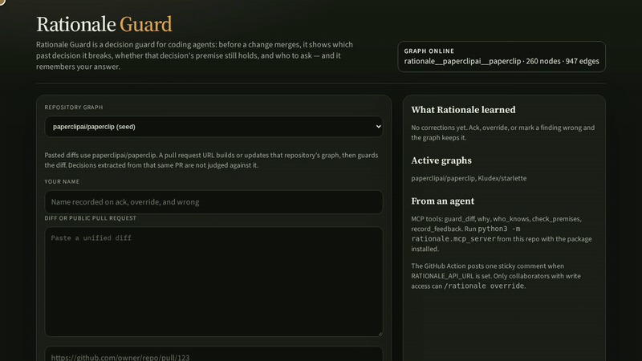
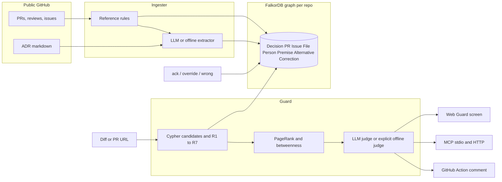
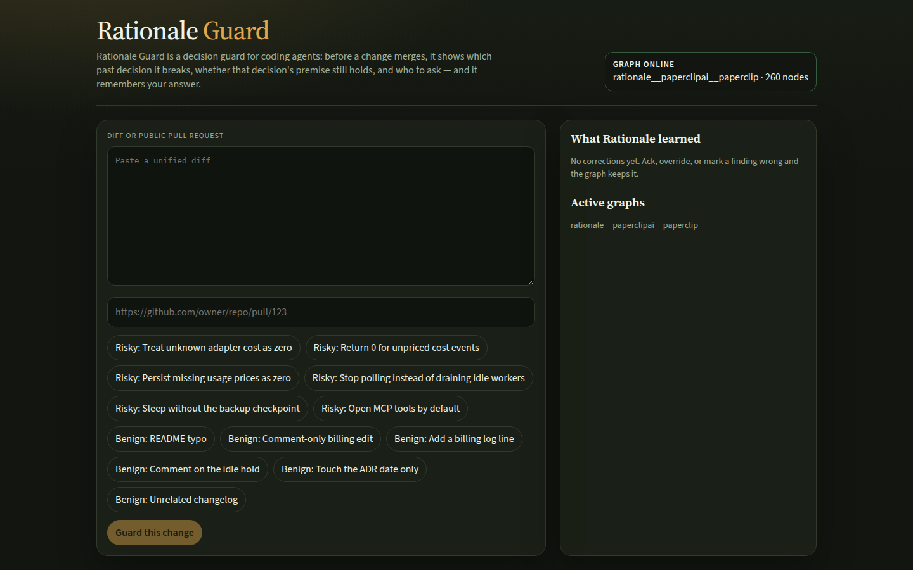
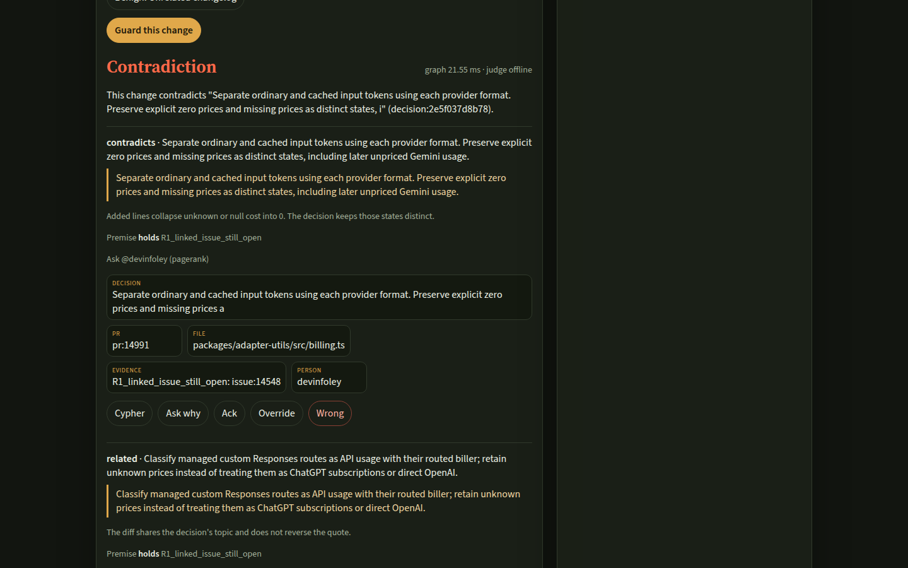
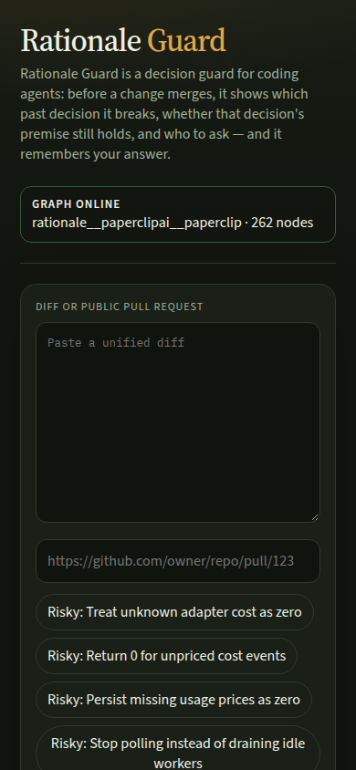

# Rationale Guard

Rationale Guard is a decision guard for coding agents: before a change merges, it shows which past decision it breaks, whether that decision's premise still holds, and who to ask — and it remembers your answer.

It is a submission for WeMakeDevs x FalkorDB **Graph Hacks: Context for AI Agents**.

## Try it

Live: [https://rationale-guard-production.up.railway.app](https://rationale-guard-production.up.railway.app)

Write-up: [My coding agent almost undid a decision it never knew existed](docs/BLOG.md)



- Press a sample button. "Treat unknown adapter cost as zero" is the diff that should warn.
- Or paste a public pull request, for example [https://github.com/Kludex/starlette/pull/3651](https://github.com/Kludex/starlette/pull/3651). The first visit builds that repository's graph, then guards the diff.

| Track | How this entry uses it |
|---|---|
| Agents That Act on Connected Data (primary) | A diff or PR URL is the trigger. FalkorDB selects the decisions, premises, rejected alternatives, and experts. The GitHub Action posts one sticky comment and a check run. MCP exposes `guard_diff` so an agent can call it before committing. |
| Company Brain | People, pull requests, issues, files, and decisions from a real public repository sit in one typed graph. "Who to ask" is PageRank on the person–file graph, not a search box. |
| Agent Memory | `ack`, `override`, and `wrong` are `Correction` nodes. An override writes a new `Decision` that `SUPERSEDES` the old one, so the next guard run changes and says what it learned. |



## Thirty-second pitch

Coding agents can see the current file and not the decision that put it there. Rationale Guard loads engineering history into FalkorDB. When a diff arrives, Cypher walks `File ← TOUCHES ← PR ← DERIVED_FROM ← Decision`, checks whether the premise still holds, lists alternatives the authors rejected, and ranks who to ask. A model is allowed only to label candidates the graph already returned, and it must quote them.

On the paperclip seed, PR [#14991](https://github.com/paperclipai/paperclip/pull/14991) records this decision: "Preserve explicit zero prices and missing prices as distinct states." A diff that collapses a missing adapter price contradicts that quote. The premise holds because the PR says `Refs #14548`, and [issue #14548](https://github.com/paperclipai/paperclip/issues/14548) is still open. PageRank on the person–file graph asks @devinfoley. A collaborator with write access can reply `/rationale override: billing now normalizes upstream`. The old decision is marked superseded, the override note is not a decision the judge can contradict, and the next guard — offline or LLM — stands down.

The seeded demo is [paperclipai/paperclip](https://github.com/paperclipai/paperclip), limited to cost accounting, idle sleep, and MCP access. Paste any other public PR URL on the Guard screen, or let the GitHub Action run. The server merges that repository's history into `rationale__<owner>__<repo>` (at most 30 PRs) and then guards the diff. A second ingest updates the same graph. It does not delete `Correction` nodes.

## AI assistance disclosure

This project was built primarily with AI coding assistants (Cursor cloud agents). A human directed product positioning, track strategy, verification, and eval. The author can explain the graph model, the Cypher rules R1–R7, the MCP surface, and the architecture. Graph Hacks requires this disclosure.

## Why a graph, not RAG

The guard's input is a diff. There is no question sentence to embed. The useful object is a path with live state:

`changed file → PR that touched it → decision derived from that PR → issue that PR references, and whether that issue is still open`

plus `REJECTED_FOR`, `SUPERSEDES`, and `EDITED`. Similarity search can return a paragraph that mentions "cost". It cannot tell you that #14548 is still open, that a later PR supersedes an older one, or that the author has left the area. Those are Cypher rules (R1–R7 below). The model never invents a decision id; if the graph returns nothing, the report says so.

## FalkorDB features used

- One graph per repository (`GRAPH` multigraph). The paperclip seed lives in `rationale__paperclipai__paperclip`.
- Parameterized Cypher only. Labels and relationship types are a fixed allow-list.
- Range indexes on `id`, `number`, and `path`.
- A fulltext index on `Decision.summary`, `rationale`, and `source_quote` for the secondary "Ask why" lookup, with a `CONTAINS` query if the index call fails.
- `algo.pageRank('Person', 'COLLABORATED')` and `algo.betweenness(...)` on the human collaboration graph built from shared file edits. If a procedure is missing, the trace records the error and degree on `EDITED` is used instead.
- Every finding stores the Cypher that selected it, with parameters and milliseconds. The graph step on the seed is under 20 ms. A guard that calls the LLM is slower: see the eval section. The 1 second target is for the graph step, not the model round trip.

## Premise rules

| Id | What it means | Severity |
|---|---|---|
| R1_fixed_issue_still_open | A merged PR uses a closing keyword on an issue that is still open | warning, premise stale |
| R1_linked_issue_still_open | A merged PR only references an issue that is still open, so the reason for the decision is still live | info, premise holds |
| R2_source_deleted | The source doc was deleted, or the implemented markdown file no longer exists | high |
| R3_adr_not_accepted | The ADR status still says pending, proposed, or draft | warning |
| R4_superseded | A newer PR or decision supersedes this one, including an override correction | high |
| R5_dependency_unmerged | The decision depends on a PR that is still open | warning |
| R6_owner_inactive | GitHub public events show the human author has no activity inside `STALE_INACTIVE_DAYS` (default 90). Ingested PRs alone are not evidence | info |
| R6_activity_unknown | The author looks quiet in the ingested slice, but there is no GitHub activity evidence, so the premise does not call them inactive | info |
| R6_author_left_area | Same GitHub evidence of inactivity, and someone else has newer merged work in the area | info |
| R7_reverted_code | A commit `REVERTS` the commit that implemented the decision | high |

On the seed graph, the cost decision's premise **holds**: paperclip PR #14991 says `Refs #14548`, not `Fixes`, and issue [#14548](https://github.com/paperclipai/paperclip/issues/14548) is still open. The MCP ADR decision is **stale** under R3 because the ADR status is accepted for MVP contracts and still pending SecurityEngineer and UXDesigner validation.

## Eval

`python3 -m eval` reloads the committed seed (it resets that graph) and prints recall, false positives, and latency. `--judge llm` uses `LLM_MODEL` (default `deepseek-chat`) and exits non-zero if any case does not receive an LLM verdict. A failed or timed-out LLM call is logged and returned as an error. It is never rewritten as an offline verdict. The offline judge runs only when you ask for it, or when `GUARD_JUDGE=auto` and no API key is configured. That choice is written on every finding as `judge`.

Candidates are judged concurrently, each with an 8 second timeout, so a diff pays about one model round trip instead of one per candidate. The graph step stays separate from that wait.

DeepSeek is called with `response_format: {type: json_object}`. List fields that arrive as strings are normalized. Internal tags such as `offline` or `decision-extract-v1` are rejected before any request.

### Cue-shaped diffs (offline)

Twelve diffs written against the same phrases the offline judge looks for. Six reverse a decision: two collapse unknown or unpriced cost toward zero (`billing.ts` and `costs.ts`), one writes a usage-checkpoint price as zero, one removes the idle drain, one skips the backup checkpoint, and one flips MCP default-deny. Six are benign: a README edit, a billing comment, an idle comment, a log line, an ADR date tweak, and an unrelated changelog.

`python3 -m eval --judge offline` on FalkorDB 4.22, 2026-10-18, this tree. The first case pays schema setup, so its graph time is higher than the rest.

| id | label | caught | graph_ms | total_ms |
|---|---|---|---|---|
| cost_null_to_zero | violates | true | 18.81 | 19.52 |
| cost_service_unpriced_to_zero | violates | true | 10.20 | 10.77 |
| usage_checkpoint_price_zero | violates | true | 8.88 | 9.05 |
| idle_stop_polling | violates | true | 8.13 | 8.25 |
| idle_skip_backup | violates | true | 6.58 | 6.68 |
| mcp_default_allow | violates | true | 6.45 | 6.68 |
| readme_typo | benign | false | 7.22 | 7.28 |
| billing_comment | benign | false | 7.63 | 7.69 |
| billing_log | benign | false | 7.51 | 7.69 |
| idle_comment | benign | false | 7.23 | 7.28 |
| adr_date_tweak | benign | false | 5.97 | 6.01 |
| changelog_note | benign | false | 8.34 | 8.40 |

Cue suite: recall **1.00** (6/6), false positives **0/6**. Across all 16 cases in the file, graph-step p50 is **7.51 ms** and total p50 is **7.69 ms**. That total is the offline judge. It is not the LLM wall time.

### Paraphrased diffs (offline)

Four extra cases avoid the offline cue words (`?? 0`, "default allow", "stop polling", "disable backup"). Three still reverse a real decision in ordinary code. One renames a local label. The offline judge does not catch the reversals. That is the point of the suite: recall 1.00 on the cue-shaped diffs is not recall on unseen wording.

| id | label | caught | graph_ms | total_ms |
|---|---|---|---|---|
| cost_missing_price_helper | violates | false | 6.54 | 6.73 |
| idle_sleep_while_busy | violates | false | 6.52 | 6.67 |
| mcp_permit_tools | violates | false | 6.58 | 6.62 |
| billing_label_rename | benign | false | 7.57 | 7.76 |

Paraphrase suite, offline: recall **0.00** (0/3), false positives **0/1**.

### Measured on af5932a (before the candidate-selection fix)

Independent verification of commit `af5932a` with `deepseek-chat`, FalkorDB 4.22.1, and all 16 cases, two LLM runs. Every case was `judge=llm`, exit 0, no fallback. These numbers predate the tie-break, the per-PR slot cap, and the scope-note filter. Re-measure after that change before quoting them as current.

| | recall | false positives | graph p50 / p95 | per-diff p50 / p95 |
|---|---|---|---|---|
| LLM run 1 | 0.89 (8/9) | 0/7 | 12.3 / 17.6 ms | 1.55 s / 2.02 s |
| LLM run 2 | 0.89 (8/9) | 0/7 | 12.3 / 16.8 ms | 1.40 s / 1.97 s |
| Offline | 0.67 (6/9) | 0/7 | 8.9 / 15.5 ms | about 9 / 16 ms |

Cue suite, both judges: recall **1.00** (6/6), false positives **0/6**. Paraphrase suite: LLM **0.67** (2/3, the miss is `cost_missing_price_helper`), offline **0.00** (0/3), false positives **0/1**. Wall time for 16 LLM cases was 25.0 s and 24.5 s.

Bring-your-own ingest with no token: Kludex/starlette#3148 took 22.1 s (9 decisions, about 27 GitHub requests). #3436 took 22.1 s (15 decisions) and merged into the same graph (23 decisions, the existing correction kept). Guard on that graph was about 1.3–1.7 s. An override under the LLM judge flipped warn to pass on the next run.

The per-case offline table higher up is an earlier local run on this tree. A later offline re-run, after the tie-break, scope-note filter, and the batched guard queries, still shows cue recall 1.00 (6/6), paraphrase recall 0.00 (0/3), overall recall 0.67 (6/9), false positives 0/7, and graph-step p50 6.24 ms. A warm guard on that run is five FalkorDB calls issued together (premises, alternatives, corrections, learned overrides, local people). The decision-to-file map and PageRank stay cached until the next ingest or correction. Latency in the per-case table is not the af5932a table in this section. The LLM numbers above were not re-measured in this environment.

## Quickstart

Docker Compose (FalkorDB browser on port 3000, app on port 8000):

```bash
cp .env.example .env
docker compose up --build
```

The app loads `data/seed/paperclip.json` when `rationale__paperclipai__paperclip` is empty. Open http://localhost:8000 and press the risky cost sample.

Without Docker, Redis plus the FalkorDB module. The UI is not in the Python package; build it or `http://localhost:8000` serves the API only.

```bash
redis-server --loadmodule /path/to/falkordb.so --port 6379 --protected-mode no
export FALKORDB_URL=redis://127.0.0.1:6379
python3 -m pip install -e ".[dev]"
python3 -m rationale.ingest load --reset
npm --prefix web ci && npm --prefix web run build
uvicorn rationale.api.main:app --port 8000
```

Open http://localhost:8000 and press the risky cost sample. `make web-build` is the same npm build.

`FALKORDB_URL` accepts `redis://` and `rediss://` (and the `falkor://` / `falkors://` aliases). The scheme is not rewritten. FalkorDB Cloud's free tier should use `redis://`; `rediss://` has been observed to hang there.

`GITHUB_TOKEN` is effectively required. One bring-your-own PR used about 27 unauthenticated GitHub requests (reviews, comments, and a public-events lookup on top of the PR walk), and two PRs nearly exhaust the unauthenticated 60-per-hour limit. The client budget is 150 requests once a token is set.

Rebuild the seed from the public GitHub API (cached under `data/cache/`, which is gitignored):

```bash
python3 -m rationale.ingest seed --mode offline
# or --mode llm when DEEPSEEK_API_KEY is set
```

Tests and eval need a reachable FalkorDB:

```bash
export FALKORDB_URL=redis://127.0.0.1:6379
python3 -m pytest
python3 -m eval --judge offline
```

## Web

Guard is the whole first screen. A repository selector chooses which graph a pasted diff is checked against. A public PR URL builds or updates that repository's graph, then guards the diff. Samples stay on the paperclip seed. Each finding shows the verbatim quote, premise rules, rejected alternatives, who to ask, the reasoning-path nodes, and the Cypher that selected that finding. "Ask why", ack, override, and wrong use the repository of the current result, including a graph built from a PR URL. Health comes from `GET /api/health`, which runs `MATCH (n) RETURN count(n)`. If FalkorDB is down the banner says so and submit is disabled. Failures are not cached. The sidebar has the MCP command and the Action's write-access rule.

## MCP

Stdio:

```bash
python3 -m rationale.mcp_server
```

HTTP: `POST /mcp` with JSON-RPC (`initialize`, `tools/list`, `tools/call`).

Tools: `guard_diff`, `why`, `who_knows`, `check_premises`, `record_feedback`.

Cursor (`.cursor/mcp.json`):

```json
{
  "mcpServers": {
    "rationale-guard": {
      "command": "python3",
      "args": ["-m", "rationale.mcp_server"],
      "cwd": "/absolute/path/to/rationale-guard",
      "env": {
        "FALKORDB_URL": "redis://127.0.0.1:6379",
        "LLM_MODEL": "deepseek-chat"
      }
    }
  }
}
```

`cwd` must be this repository, and that `python3` must be an interpreter where `pip install -e .` has been run. Set `DEEPSEEK_API_KEY` in the environment when you want the LLM judge. Leave it unset to stay on the offline judge. Do not paste the key into a committed file. Claude Desktop uses the same command, args, and cwd. Point an agent at `guard_diff` before it edits `billing.ts`.

## GitHub Action

`.github/workflows/rationale-guard.yml` runs only after you set the repository variable `RATIONALE_API_URL` to a Rationale Guard server that can reach FalkorDB. On `pull_request`, the action asks that server to build or update `rationale__<owner>__<repo>` and then guard the PR diff. It upserts one comment marked `<!-- rationale-guard -->` and completes a neutral check run on the **PR head SHA**. An `issue_comment` does not use `GITHUB_SHA`, which would attach the check to the default branch.

`/rationale ack|override|wrong <reason>` is accepted only from commenters GitHub marks as `OWNER`, `MEMBER`, or `COLLABORATOR`, or from a login the permission API says can write. Anyone else gets a comment that the command was ignored. You can name a decision: `/rationale override decision:<id> <reason>`. Without an id, the command attaches to the first contradicting finding.

The server should have `GITHUB_TOKEN` set; otherwise the first ingest of a non-trivial PR will hit GitHub's unauthenticated rate limit. `load --reset` is the explicit wipe. PR ingest merges. Install the workflow only on repositories you own. This project does not write to `paperclipai/paperclip`.

## Deploy

The `Dockerfile` builds the Vite UI and serves it from FastAPI. Railway reads `PORT`.

| Variable | Purpose |
|---|---|
| `FALKORDB_URL` | `redis://` or `rediss://` to your FalkorDB. Use a private host in production. |
| `DEEPSEEK_API_KEY` | Optional. Without it, extraction and judging stay on the explicit offline path. |
| `LLM_BASE_URL` | Default `https://api.deepseek.com`. Any OpenAI-compatible `/chat/completions` URL. |
| `LLM_MODEL` | Default `deepseek-chat`. DeepSeek also documents `deepseek-flash` and `deepseek-v4-pro`. |
| `GITHUB_TOKEN` | Effectively required. Unauthenticated ingest spends about 25–30 GitHub requests per PR. |
| `GUARD_JUDGE` | `auto` (default), `offline`, or `llm`. |
| `STALE_INACTIVE_DAYS` | Default 90. |

Run FalkorDB as a second service (`falkordb/falkordb`) with a volume on `/var/lib/falkordb/data`. Do not depend on the Cloud free tier as the only copy: it is small, it sleeps, and it can be deleted. `docker compose` is the setup this repo actually runs. A keepalive workflow calls `GET /api/health` every 6 hours when `RATIONALE_PUBLIC_URL` is set.

## Screenshots








## Data

`data/seed/paperclip.json` was produced by this repository's ingester (`python3 -m rationale.ingest seed --mode offline`) from the public GitHub API. It is not a hand-written decision list. Quotes are substrings of PR bodies, issue #14548, or `doc/plans/2026-06-05-agent-access-mcp-runtime-slots-adr.md`. Closed-unmerged PR #15614 is a `rejected` decision because GitHub shows it closed and unmerged; its text is still a verbatim span, not a manual edge.

Bring-your-own-PR: `POST /api/ingest` with `{pr_url}`. The job fetches the PR's files (cap 20), walks commits on those paths from the last 18 months, keeps at most 30 PRs and 150 GitHub requests, extracts decisions, loads `rationale__owner__repo`, and guards the PR diff. Two ingests per hour per IP. Private repositories are refused.

## Honest limitations

- The seed is three areas of one repository, not a whole company. Other areas are absent until you ingest them.
- The committed seed was extracted without an LLM, by a cue scorer that keeps a verbatim span. It misses decisions that are not written in that vocabulary, and it can keep a sentence that is a constraint but not a formal ADR. The LLM extractor is in the same module and drops quotes that are not verbatim. It was not used for the committed file.
- The offline judge is a deterministic polarity check (null/unknown versus 0, default-deny versus allow, drain/backup versus "stop polling" / "disable backup"). It misses the paraphrased diffs in `eval/cases.yaml` (recall 0/3). Use the LLM judge when a key is configured. Eval exits non-zero if that judge falls back or times out.
- PageRank on a nine-PR graph is real but thin. Several files have a single human author, so the card shows a bus factor of 1.
- #14548 is referenced, not closed, by the cost PRs. R1 therefore reports a live premise, not a "claimed fixed but still open" warning. That matches the text.
- Ingest without `GITHUB_TOKEN` is not practical past a single small PR. Set the token.
- The Action does not block merges (check conclusion is `neutral`). It comments. You can require the check in branch protection if you want it to gate.
- `POST /api/feedback` on the HTTP API is not authenticated. The GitHub Action is the surface that checks write access before it calls that endpoint. Do not expose the API on the public internet without a network boundary.
- No hosted demo is included in this repository. `docker compose up --build` is the path a judge can run. LLM latency after the concurrent-judge change has not been re-measured; the 6.6 s figure is the sequential run.

## Prior work and assistance

The product idea and the graph rules were designed before the event. Every line in this repository was written during the event window in this public repo. An AI coding agent in Cursor wrote the implementation from those design notes and from the public GitHub API. No source was copied from another repository.

## License

MIT. See the source headers; GitHub content in the seed remains under the upstream project's license.
