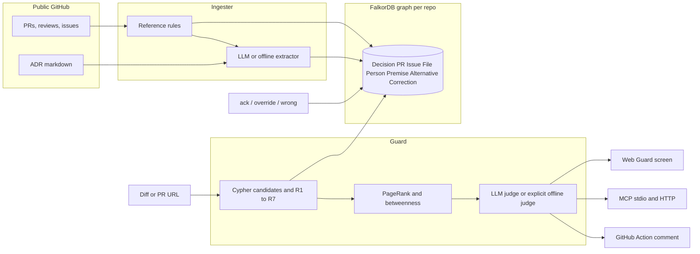

# Rationale Guard

Rationale Guard is a decision guard for coding agents: before a change merges, it shows which past decision it breaks, whether that decision's premise still holds, and who to ask — and it remembers your answer.

It is a submission for WeMakeDevs x FalkorDB **Graph Hacks: Context for AI Agents**.

| Track | How this entry uses it |
|---|---|
| Agents That Act on Connected Data (primary) | A diff or PR URL is the trigger. FalkorDB selects the decisions, premises, rejected alternatives, and experts. The GitHub Action posts one sticky comment and a check run. MCP exposes `guard_diff` so an agent can call it before committing. |
| Company Brain | People, pull requests, issues, files, and decisions from a real public repository sit in one typed graph. "Who to ask" is PageRank on the person–file graph, not a search box. |
| Agent Memory | `ack`, `override`, and `wrong` are `Correction` nodes. An override writes a new `Decision` that `SUPERSEDES` the old one, so the next guard run changes and says what it learned. |



## Thirty-second pitch

Coding agents can see the current file and not the decision that put it there. Rationale Guard loads engineering history into FalkorDB. When a diff arrives, Cypher walks `File ← TOUCHES ← PR ← DERIVED_FROM ← Decision`, checks whether the premise still holds, lists alternatives the authors rejected, and ranks who to ask. A model is allowed only to label candidates the graph already returned, and it must quote them. If you reply `/rationale override: billing now normalizes upstream`, that correction becomes a node and the next run stands down.

The seeded demo is [paperclipai/paperclip](https://github.com/paperclipai/paperclip), limited to cost accounting, idle sleep, and MCP access. Paste any other public PR URL and the same pipeline builds a separate graph, `rationale__<owner>__<repo>`, from the history of the files that PR touches (at most 30 PRs).

## Why a graph, not RAG

The guard's input is a diff. There is no question sentence to embed. The useful object is a path with live state:

`changed file → PR that touched it → decision derived from that PR → issue that PR references, and whether that issue is still open`

plus `REJECTED_FOR`, `SUPERSEDES`, and `EDITED`. Similarity search can return a paragraph that mentions "cost". It cannot tell you that #14548 is still open, that a later PR supersedes an older one, or that the author has left the area. Those are Cypher rules (R1–R7 below). The model never invents a decision id; if the graph returns nothing, the report says so.

## FalkorDB features used

- One graph per repository (`GRAPH` multigraph). The paperclip seed lives in `rationale__paperclipai__paperclip`.
- Parameterized Cypher only. Labels and relationship types are a fixed allow-list.
- Range indexes on `id`, `number`, and `path`.
- A fulltext index on `Decision.summary`, `rationale`, and `source_quote` for the secondary "Ask why" lookup, with a `CONTAINS` query if the index call fails.
- `algo.pageRank('Person', 'COLLABORATED')` and `algo.betweenness(...)` on the human collaboration graph built from shared file edits. If a procedure is missing, the trace records the error and degree on `EDITED` is used instead.
- Every finding stores the Cypher text, parameters, and milliseconds. On the seed graph the graph step is about 6 ms (p50), under the 1 second target.

## Premise rules

| Id | What it means | Severity |
|---|---|---|
| R1_fixed_issue_still_open | A merged PR uses a closing keyword on an issue that is still open | warning, premise stale |
| R1_linked_issue_still_open | A merged PR only references an issue that is still open, so the reason for the decision is still live | info, premise holds |
| R2_source_deleted | The source doc was deleted, or the implemented markdown file no longer exists | high |
| R3_adr_not_accepted | The ADR status still says pending, proposed, or draft | warning |
| R4_superseded | A newer PR or decision supersedes this one, including an override correction | high |
| R5_dependency_unmerged | The decision depends on a PR that is still open | warning |
| R6_owner_inactive | The human author has been inactive for `STALE_INACTIVE_DAYS` (default 90) | info |
| R6_author_left_area | Someone else has newer merged work in the area than the author's last activity | info |
| R7_reverted_code | A commit `REVERTS` the commit that implemented the decision | high |

On the seed graph, the cost decision's premise **holds**: paperclip PR #14991 says `Refs #14548`, not `Fixes`, and issue [#14548](https://github.com/paperclipai/paperclip/issues/14548) is still open. The MCP ADR decision is **stale** under R3 because the ADR status is accepted for MVP contracts and still pending SecurityEngineer and UXDesigner validation.

## Eval

Twelve labelled diffs on the committed seed. Six reverse a decision (unknown cost collapsed to 0, unpriced cost returned as 0, idle drain removed, backup checkpoint skipped, MCP default-deny flipped to allow). Six are benign (README, comments, a log line, an ADR date tweak, an unrelated changelog).

`python3 -m eval --judge offline` against FalkorDB 4.22:

| id | label | caught | status | findings | judge | graph_ms |
|---|---|---|---|---|---|---|
| cost_null_to_zero | violates | true | warn | 2 | offline | 13.02 |
| cost_service_unpriced_to_zero | violates | true | warn | 1 | offline | 6.45 |
| usage_checkpoint_price_zero | violates | true | warn | 1 | offline | 6.93 |
| idle_stop_polling | violates | true | warn | 5 | offline | 7.19 |
| idle_skip_backup | violates | true | warn | 5 | offline | 5.82 |
| mcp_default_allow | violates | true | warn | 2 | offline | 5.48 |
| readme_typo | benign | false | pass | 0 | offline | 5.92 |
| billing_comment | benign | false | pass | 0 | offline | 6.11 |
| billing_log | benign | false | pass | 0 | offline | 6.36 |
| idle_comment | benign | false | pass | 0 | offline | 6.19 |
| adr_date_tweak | benign | false | pass | 0 | offline | 5.22 |
| changelog_note | benign | false | pass | 0 | offline | 5.61 |

Recall **1.00** (6/6). False positives **0/6**. Graph-step p50 **6.19 ms**.

`python3 -m eval --judge llm` uses `LLM_MODEL` (default `deepseek-chat`) and exits non-zero if any case does not receive an LLM verdict. A failed LLM call is logged and returned as an error. It is never rewritten as an offline verdict. The offline judge runs only when you ask for it, or when `GUARD_JUDGE=auto` and no API key is configured. That choice is written on every finding as `judge`.

DeepSeek is called with `response_format: {type: json_object}`. List fields that arrive as strings are normalized. Internal tags such as `offline` or `decision-extract-v1` are rejected before any request.

## Quickstart

Docker Compose (FalkorDB browser on port 3000, app on port 8000):

```bash
cp .env.example .env
docker compose up --build
```

The app loads `data/seed/paperclip.json` when `rationale__paperclipai__paperclip` is empty. Open http://localhost:8000 and press the risky cost sample.

Without Docker, Redis plus the FalkorDB module:

```bash
redis-server --loadmodule /path/to/falkordb.so --port 6379 --protected-mode no
export FALKORDB_URL=redis://127.0.0.1:6379
python3 -m pip install -e ".[dev]"
python3 -m rationale.ingest load --reset
uvicorn rationale.api.main:app --port 8000
```

`FALKORDB_URL` accepts `redis://` and `rediss://` (and the `falkor://` / `falkors://` aliases). The scheme is not rewritten. FalkorDB Cloud's free tier should use `redis://`; `rediss://` has been observed to hang there.

Rebuild the seed from the public GitHub API (cached under `data/cache/`, which is gitignored):

```bash
python3 -m rationale.ingest seed --mode offline
# or --mode llm when DEEPSEEK_API_KEY is set
```

Tests and eval need a reachable FalkorDB:

```bash
export FALKORDB_URL=redis://127.0.0.1:6379
python3 -m pytest
python3 -m eval --judge offline
```

## Web

Guard is the whole first screen: paste a diff or a public PR URL, or use a sample. Each finding shows the verbatim quote, premise rules, rejected alternatives, who to ask, the reasoning-path nodes, and the Cypher that produced them. "Ask why" is a secondary action on a finding, not a home-page chat box. Ack, override, and wrong write `Correction` nodes. Health comes from `GET /api/health`, which runs `MATCH (n) RETURN count(n)`. If FalkorDB is down the banner says so and submit is disabled. Failures are not cached.

## MCP

Stdio:

```bash
python3 -m rationale.mcp_server
```

HTTP: `POST /mcp` with JSON-RPC (`initialize`, `tools/list`, `tools/call`).

Tools: `guard_diff`, `why`, `who_knows`, `check_premises`, `record_feedback`.

Cursor (`.cursor/mcp.json`):

```json
{
  "mcpServers": {
    "rationale-guard": {
      "command": "python3",
      "args": ["-m", "rationale.mcp_server"],
      "env": {
        "FALKORDB_URL": "redis://127.0.0.1:6379",
        "DEEPSEEK_API_KEY": "",
        "LLM_MODEL": "deepseek-chat"
      }
    }
  }
}
```

Claude Desktop uses the same command and args. Point an agent at `guard_diff` before it edits `billing.ts` or the MCP ADR.

## GitHub Action

`.github/workflows/rationale-guard.yml` runs `action/post_guard.py` when the repository variable `RATIONALE_API_URL` is set. It upserts a single comment marked `<!-- rationale-guard -->` and completes a neutral check run. A comment that starts with `/rationale ack|override|wrong <reason>` is stored and the guard runs again. Install it only on repositories you own. This project does not write to `paperclipai/paperclip`.

## Deploy

The `Dockerfile` builds the Vite UI and serves it from FastAPI. Railway reads `PORT`.

| Variable | Purpose |
|---|---|
| `FALKORDB_URL` | `redis://` or `rediss://` to your FalkorDB. Use a private host in production. |
| `DEEPSEEK_API_KEY` | Optional. Without it, extraction and judging stay on the explicit offline path. |
| `LLM_BASE_URL` | Default `https://api.deepseek.com`. Any OpenAI-compatible `/chat/completions` URL. |
| `LLM_MODEL` | Default `deepseek-chat`. DeepSeek also documents `deepseek-flash` and `deepseek-v4-pro`. |
| `GITHUB_TOKEN` | Optional, raises the GitHub REST rate limit for bring-your-own-PR ingest. |
| `GUARD_JUDGE` | `auto` (default), `offline`, or `llm`. |
| `STALE_INACTIVE_DAYS` | Default 90. |

Run FalkorDB as a second service (`falkordb/falkordb`) with a volume on `/var/lib/falkordb/data`. Do not depend on the Cloud free tier as the only copy: it is small, it sleeps, and it can be deleted. `docker compose` is the setup this repo actually runs. A keepalive workflow calls `GET /api/health` every 6 hours when `RATIONALE_PUBLIC_URL` is set.

## Screenshots


## Data

`data/seed/paperclip.json` was produced by this repository's ingester (`python3 -m rationale.ingest seed --mode offline`) from the public GitHub API. It is not a hand-written decision list. Quotes are substrings of PR bodies, issue #14548, or `doc/plans/2026-06-05-agent-access-mcp-runtime-slots-adr.md`. Closed-unmerged PR #15614 is a `rejected` decision because GitHub shows it closed and unmerged; its text is still a verbatim span, not a manual edge.

Bring-your-own-PR: `POST /api/ingest` with `{pr_url}`. The job fetches the PR's files (cap 20), walks commits on those paths from the last 18 months, keeps at most 30 PRs and 150 GitHub requests, extracts decisions, loads `rationale__owner__repo`, and guards the PR diff. Two ingests per hour per IP. Private repositories are refused.

## Honest limitations

- The seed is three areas of one repository, not a whole company. Other areas are absent until you ingest them.
- The committed seed was extracted without an LLM, by a cue scorer that keeps a verbatim span. It misses decisions that are not written in that vocabulary, and it can keep a sentence that is a constraint but not a formal ADR. The LLM extractor is in the same module and drops quotes that are not verbatim. It was not used for the committed file.
- The offline judge is a deterministic polarity check (null/unknown versus 0, default-deny versus allow, drain/backup versus "stop polling" / "disable backup"). It is not a substitute for reading the diff. The LLM judge is the one to use when a key is configured; eval fails if that judge falls back.
- PageRank on a nine-PR graph is real but thin. Several files have a single human author, so the card shows a bus factor of 1.
- #14548 is referenced, not closed, by the cost PRs. R1 therefore reports a live premise, not a "claimed fixed but still open" warning. That matches the text.
- Ingest of an arbitrary popular PR can hit GitHub's unauthenticated rate limit. Set `GITHUB_TOKEN`.
- The Action does not block merges (check conclusion is `neutral`). It comments. You can require the check in branch protection if you want it to gate.
- No hosted demo is included in this repository. `docker compose up --build` is the path a judge can run.

## Prior work and assistance

The product idea and the graph rules were designed before the event. Every line in this repository was written during the event window in this public repo. An AI coding agent (Cursor Grok 4.7) wrote the implementation from those design notes and from the public GitHub API. No source was copied from another repository.

## License

MIT. See the source headers; GitHub content in the seed remains under the upstream project's license.
