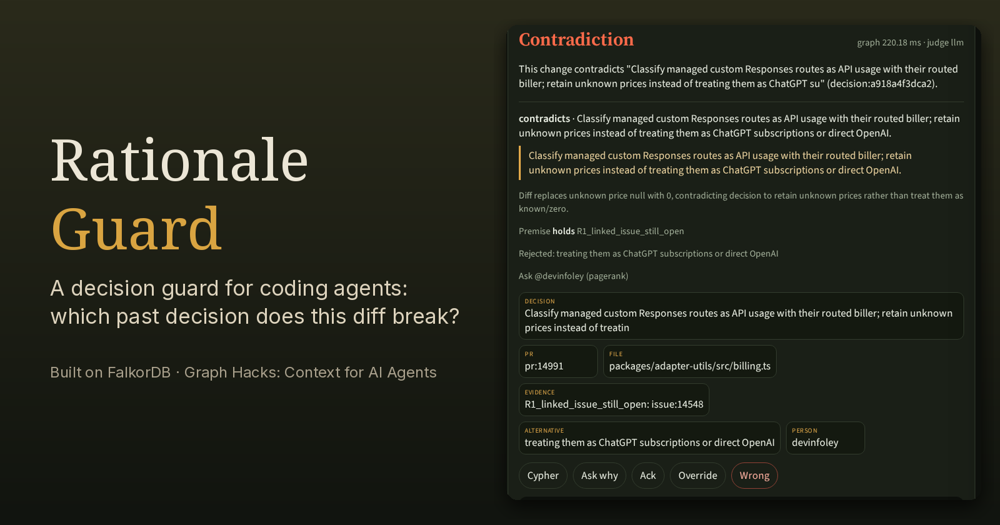
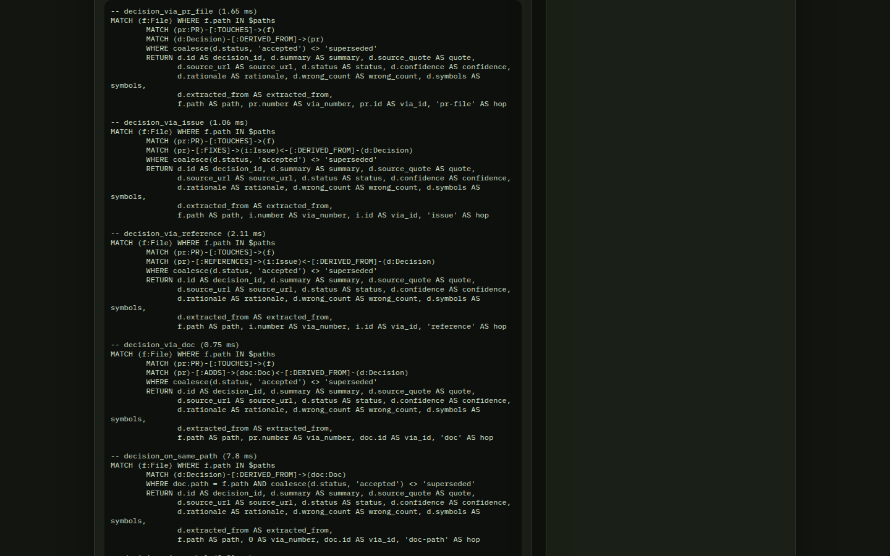
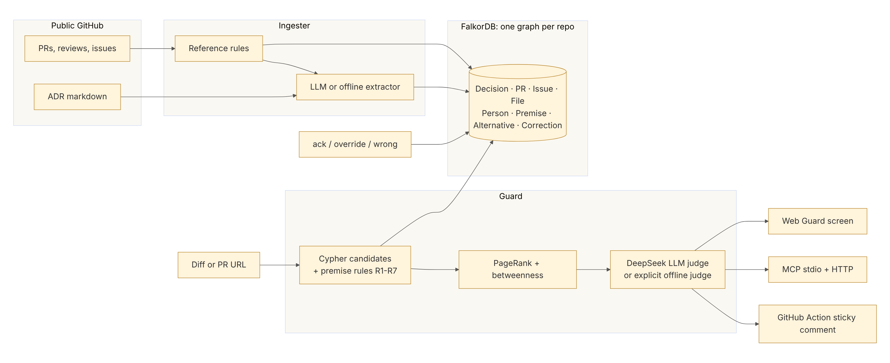
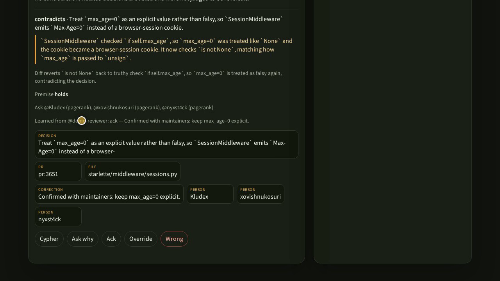

# My coding agent almost undid a decision it never knew existed

Rationale Guard: a FalkorDB graph that tells you which past decision a diff breaks, whether its premise still holds, and who to ask.



Live: https://rationale-guard-production.up.railway.app
Code (MIT): https://github.com/lurui1997/rationale-guard
Demo video: https://github.com/lurui1997/rationale-guard/releases/download/demo-video-v1/rationale-guard-demo.mp4 ([release](https://github.com/lurui1997/rationale-guard/releases/tag/demo-video-v1))

*Built for WeMakeDevs × FalkorDB **Graph Hacks: Context for AI Agents**. Primary track: Agents That Act on Connected Data (also Company Brain and Agent Memory).*

## The one-line diff

The pull request looked harmless. In `packages/adapter-utils/src/billing.ts` someone, or something, changed one expression:

```diff
-  const price = usage.cost ?? null;
+  const price = usage.cost ?? 0; // treat unknown as zero
```

A reviewer skimming the diff sees a null turned into a real value. A coding agent sees a type error go away. Neither of them is looking at issue [#14548](https://github.com/paperclipai/paperclip/issues/14548) on [paperclipai/paperclip](https://github.com/paperclipai/paperclip). That issue is still open, and it says the cost API returns `costCents: 0` with no way to tell "the cost is zero" from "we don't know the cost." They are also not looking at PR [#14991](https://github.com/paperclipai/paperclip/pull/14991), which says, verbatim:

> Classify managed custom Responses routes as API usage with their routed biller; retain unknown prices instead of treating them as ChatGPT subscriptions or direct OpenAI.

and, in a sibling decision from the same area:

> Preserve explicit zero prices and missing prices as distinct states, including later unpriced Gemini usage.

Those sentences are the decision, and the one-line diff contradicts them. The premise is still live, because #14548 was *referenced* and never closed. The person to ask is the human who actually edits those files.

Agents, and developers in their first week, undo decisions they never saw. Rationale Guard tells you before the change merges.


## Why a graph and not RAG

A diff has paths and lines. It doesn't contain a question. Embedding "unknown cost" and fetching the nearest paragraphs will turn up #14548, along with a dozen unrelated pricing comments. It won't tell you that #14991 links the issue with `Refs`, not `Fixes`, that the issue is `OPEN` today, or that someone overrode the decision last week. That's all state on edges, and similarity search doesn't see edges.

The question a diff actually asks is about structure:

> Which past decision was implemented by a change to *this file*? Does that decision still rest on an open issue, a pending ADR, an unmerged dependency, a reverted commit? What did the authors refuse to do instead? Who still works here?

In Rationale Guard that question is a set of parameterized multi-hop Cypher queries. This is the first one, taken directly from `rationale/guard.py`:

```cypher
MATCH (f:File) WHERE f.path IN $paths
MATCH (pr:PR)-[:TOUCHES]->(f)
MATCH (d:Decision)-[:DERIVED_FROM]->(pr)
WHERE coalesce(d.status, 'accepted') <> 'superseded'
  AND coalesce(d.extractor, '') <> 'correction'
RETURN d.id AS decision_id, d.source_quote AS quote, d.source_url AS source_url,
       f.path AS path, pr.number AS via_number, 'pr-file' AS hop
```

Sibling queries go one hop further. They follow `File ← TOUCHES ← PR → FIXES/REFERENCES → Issue ← DERIVED_FROM ← Decision` and `PR → ADDS → Doc ← DERIVED_FROM ← Decision`, so a decision written down in an ADR still catches a diff to a file that came in with the PR that added the ADR. A symbol hop covers renamed or new paths that use old identifiers.

Premise checks are Cypher too. Here is rule R1 from `rationale/premises.py`, the one that fired on the cost diff:

```cypher
MATCH (d:Decision)-[:DERIVED_FROM]->(pr:PR)-[r:REFERENCES]->(i:Issue {state: 'OPEN'})
WHERE d.id IN $ids
RETURN d.id AS decision_id, pr.id AS left_id, i.id AS right_id,
       'linked issue #' + toString(i.number) + ' is still open' AS detail
```

The difference between the two variants matters. If a merged PR says `Fixes #N` and the issue is still open, the "we fixed it" premise is stale, and that's a warning. If it only says `Refs #N`, the reason for the decision is still open, so the premise holds. Other rules read ADR status (R3), follow `SUPERSEDES` (R4), follow `REVERTS` (R7), and mark an author inactive only when GitHub's public events say so (R6).

The UI shows every query it ran. Open **Cypher** on a finding and you get the exact statements and their timings. The reasoning-path chips are the nodes those queries returned.



## What FalkorDB does here

The graph isn't a place to park JSON. One FalkorDB instance gives us:

- **One graph per repository.** The seed is `rationale__paperclipai__paperclip`. Paste a public PR URL and the app builds `rationale__Kludex__starlette` next to it, so the two companies' memories never mix.
- **Fast parameterized multi-hop Cypher.** The candidate, premise, alternative, correction and people queries run as five concurrent calls. The graph step is about 220 ms warm on the hosted Railway deployment.
- **Graph algorithms as procedures.** We materialize `COLLABORATED` edges between people who edit the same files, then rank them in the database:

```cypher
CALL algo.pageRank('Person', 'COLLABORATED') YIELD node, score
RETURN node.login AS login, score
```

`algo.betweenness` is called the same way. The ranked list is intersected with the people who actually edited the files in the diff. On the cost files that's `@devinfoley`, and the card reports a bus factor of 1, because it is 1.

- **Indexes plus fulltext.** There are range indexes on every node id, and `db.idx.fulltext.createNodeIndex('Decision', 'summary', 'rationale', 'source_quote')` backs the secondary "why" lookups.



Ingest goes from the public GitHub API, through rule-based edges (`Fixes` gives `FIXES`, `Refs` gives `REFERENCES`, and `[bot]` accounts are kept for audit but left out of "who to ask"), then a DeepSeek extractor (or an explicit offline extractor). A decision is kept **only if its quote is a substring of the source artifact**.

## The guard flow

1. **Paste a diff or a public PR URL.** For a URL, the app fetches up to 20 changed files and walks their history from the last 18 months, capped at 30 PRs. It extracts decisions, merges them into that repo's graph, and guards the PR's own diff.
2. **The graph selects candidates.** These are the Cypher hops above, followed by the premise rules, rejected `Alternative` nodes (`REJECTED_FOR`), and experts.
3. **A judge labels them.** The DeepSeek judge gets the verbatim quote and the hunk, and has to return `contradicts`, `related`, or `unrelated`. Unrelated candidates are dropped. The model never retrieves anything. It only labels what the graph returned. If you asked for the LLM judge and the call fails, the request fails. There's no silent fallback.
4. **The card shows its evidence:** the verbatim quote and source link, premise status and rule IDs, rejected alternatives, who to ask, the reasoning-path subgraph, and the executed Cypher.

A README typo touches no file that carries a decision, so it passes.

The same thing works on a repository we didn't seed. I pasted [Kludex/starlette#3651](https://github.com/Kludex/starlette/pull/3651), and the app built a Starlette graph from public data. Then I pasted a diff that turns `if self.max_age is not None:` back into `if self.max_age:`. Guard warned on the decision *"Treat `max_age=0` as an explicit value rather than as unset in `SessionMiddleware`"* and quoted the PR:

> `SessionMiddleware` checked `if self.max_age`, so `max_age=0` was treated like `None` and the cookie became a browser-session cookie. It now checks `is not None`, matching how `max_age` is passed to `unsign`.

It recommended asking `@Kludex` first, by PageRank.

## Memory from corrections

"The agent remembers" shouldn't mean a 24-hour cache. In Rationale Guard, every correction is a node:

```cypher
MERGE (c:Correction {id: $id})
SET c.kind = $kind, c.text = $text, c.by = $by, c.at = $at
MERGE (c)-[:ABOUT]->(d:Decision {id: $decision})
```

- **ack** keeps the finding and records who acknowledged it and why. The next run shows "Learned from @… : ack".
- **wrong** multiplies that decision's match score by 0.25, so it drops below better candidates.
- **override** marks the old decision `superseded` and writes a new `Decision` that `SUPERSEDES` it, using the reason you typed. The next guard run doesn't warn on the old quote, and it says it learned the override.

Because corrections live in FalkorDB, they survive restarts and re-ingests. Re-ingesting a repo merges new history and never deletes `Correction` nodes.



## MCP and the GitHub Action: the agent acts

The point is for the *agent* to ask the graph before it edits. `python3 -m rationale.mcp_server` (stdio) and `POST /mcp` (JSON-RPC over HTTP) expose five tools: `guard_diff`, `why`, `who_knows`, `check_premises`, `record_feedback`. A call to the live server returns the same decision, the same premise (`linked issue #14548 is still open`), and the same expert, in a form an agent can act on, for example by keeping unknown as `null`.

For humans, `action/post_guard.py` runs as a GitHub Action. It upserts one sticky comment marked `<!-- rationale-guard -->` and posts a neutral check run on the PR head SHA. `/rationale ack|override|wrong <reason>` is accepted only from commenters with write access.

## Honest numbers

These are from the live deployment (Railway, FalkorDB, DeepSeek judge) on the 16 labelled diffs in `eval/cases.yaml`:

| Metric | Result |
|---|---|
| Recall on contradicting diffs | **0.89** (8/9) |
| False positives on benign diffs | **0** (0/7) |
| Cue-word contradictions | 6/6 |
| Paraphrased contradictions | 2/3 |
| Guard end to end | ~1.7 s |
| Graph step (warm) | ~220 ms |

## Limitations

- **Small eval.** Sixteen cases is a sanity check, not a benchmark. Paraphrased contradictions are the weak spot (2/3).
- **Seed scope.** The seed covers three areas of one public repo (cost accounting, idle sleep, MCP access). It isn't a whole company. Anything you haven't ingested doesn't exist to the guard.
- **Extraction misses things.** The committed seed came from the deterministic offline extractor. It misses decisions phrased without decision-like cue words. The LLM extractor is stricter, and both drop any quote that isn't verbatim.
- **Thin PageRank.** On a graph built from a handful of PRs PageRank is real but thin, and many files have a bus factor of 1.
- **It doesn't block merges.** The Action's check is neutral on purpose. It comments, and you can make the check required yourself.
- **GitHub rate limits.** Ingest needs `GITHUB_TOKEN`. One PR costs roughly 25–30 GitHub API requests, and ingest on the public demo is rate-limited.
- **Open feedback endpoint.** `POST /api/feedback` on the HTTP API is unauthenticated. The Action checks write access before calling it, so keep the API behind a network boundary in real use.

## What's next

- A larger, harder eval set focused on paraphrased and multi-file contradictions.
- Incremental ingest from webhooks instead of on-demand history walks.
- Pulling decisions from more sources (ADRs across repos, design docs, review threads) into the same per-repo graph.
- A pre-commit hook and editor integration that call `guard_diff` locally.
- Ways to weight time and authorship (a decision by someone still active vs. one whose authors have all left).

## Links

- Live app: https://rationale-guard-production.up.railway.app
- Code (MIT): https://github.com/lurui1997/rationale-guard
- Demo video: https://github.com/lurui1997/rationale-guard/releases/download/demo-video-v1/rationale-guard-demo.mp4
- Release: https://github.com/lurui1997/rationale-guard/releases/tag/demo-video-v1
- FalkorDB: https://www.falkordb.com
- Hackathon: WeMakeDevs × FalkorDB, Graph Hacks: Context for AI Agents

*The agent wasn't wrong about JavaScript. It was wrong about a decision it never saw. The graph is how you hand that decision to the agent without trusting the agent to remember it.*
